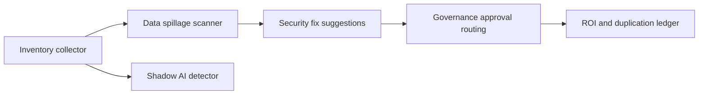

Visibility over every AI-generated workflow, agent, app and AI-written repo running at Real Chemistry — built for the CISO. One page answers: what exists, who owns it, what data it touches, where data is leaking, which AI tools nobody approved, what is stuck in governance, and what it's all worth in personnel hours.

**Entry point:** [Control Tower](<Control Tower/App.tsx>) at `/ai-governance` (space members only). It reads [Governance data API](<Governance data API/script.ts>) at `/ai-governance/data` and posts decisions to [Governance actions](<Governance actions/script.ts>) at `/ai-governance/action`. Both APIs are space-authenticated too.

**Scheduled pipeline:** [Inventory collector](<Inventory collector/script.ts>) runs daily at 07:00 UTC and fans out:

Each step publishes to the shared `ai_governance` volume; the dashboard reads it, and only the actions API writes human decisions.

1. **Inventory collector** — normalizes builds from 3B/Tines, Claude Code, Replit and the GitHub security suite, with per-source coverage percentages.
2. **Data spillage scanner** — pattern-matches logs and IO for PHI, PII, plaintext secrets, client-confidential content and unapproved egress; stores matches masked.
3. **Shadow AI detector** — compares Microsoft Defender and EDR / SIEM observations against a self-updating allow/block list held in the volume, enriches unknown tools, proposes allow or block.
4. **Security fix suggestions** — one concrete security or bug fix per finding, with a before/after diff and an approve/reject decision. Optimisation and productivity advice are out of scope by design.
5. **Governance approval routing** — moves flagged items through AI Working Group → AI Board → Business → Security/IT → Finance → Trial → Implement/Kill, with a fast-track lane for low-risk items in use under a week, writing an immutable audit record on every state change.
6. **ROI and duplication ledger** — personnel hours saved per build and team over 90 days, a dollar translation at a configurable blended rate, and duplicate-effort pairs.

**Data today is mock, and deliberately so.** No credentials are needed to run the demo. Every integration is isolated behind one module per step — `Inventory collector/sources.ts`, `Shadow AI detector/feed.ts`, `Security fix suggestions/suggest.ts` — each naming the real endpoint it would call. Swapping in a live API means replacing that module's body and attaching a connector; nothing downstream changes.

**LLM-agnostic.** Model choice is a config value per step (`GOVERNANCE_MODEL`, `SHADOW_ENRICHMENT_MODEL`, `FIX_MODEL`), and the app shows which model produced each output, so Claude, OpenAI or Gemini is a config change.

**Side effects:** all writes stay inside this workflow's `ai_governance` volume. Nothing is sent to an external system, no tool is actually blocked, and no code is actually patched — approvals are recorded decisions plus an audit trail, ready to be wired to a proxy, ticketing system or repo PR.

**Common changes**

- Detection patterns: [Data spillage scanner/patterns.ts](<Data spillage scanner/patterns.ts>)
- Approved egress domains and risk weights: [Inventory collector/script.ts](<Inventory collector/script.ts>)
- Blended hourly rate and duplicate threshold: [ROI and duplication ledger/config.ts](<ROI and duplication ledger/config.ts>)
- Approval stages and the fast-track lane: [Governance approval routing/stages.ts](<Governance approval routing/stages.ts>)
- Fix recipes and the scope guard prompt: [Security fix suggestions/suggest.ts](<Security fix suggestions/suggest.ts>)
- Brand tokens and layout: [Control Tower/globals.css](<Control Tower/globals.css>), [Control Tower/ui](<Control Tower/ui/kit.tsx>)
