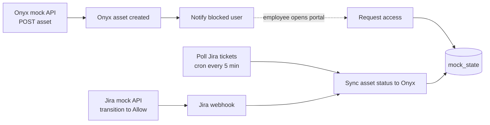

An end-to-end demo of AI asset governance between [Onyx Security](https://onyx.security/) and Jira: when Onyx discovers a new AI asset it is blocked by default, the employee who hit the block raises a Jira approval request, an admin moves the ticket to **Allow**, and 3B pushes that decision straight back into Onyx.

Both external systems are **mocked inside this workflow** — Onyx has no public API spec yet and Jira is stubbed so the demo runs with no credentials. No connectors are attached and nothing leaves the tenant.

#### The flow

1. **[Onyx mock API](<Onyx mock API/README.md>)** registers a discovered asset and forces `status = blocked`.
2. **[Onyx asset created](<Onyx asset created/README.md>)** picks up the discovery event and **[Notify blocked user](<Notify blocked user/README.md>)** composes the "blocked — request approval" message.
3. The employee uses the **[Asset portal](<Asset portal/README.md>)**; **[Request access](<Request access/README.md>)** opens a Jira approval issue and moves the asset to `pending_review`.
4. An admin transitions the issue in the **[Jira mock API](<Jira mock API/README.md>)**; **[Jira webhook](<Jira webhook/README.md>)** normalizes the changelog into a decision, and **[Poll Jira tickets](<Poll Jira tickets/README.md>)** catches anything the webhook missed.
5. **[Sync asset status to Onyx](<Sync asset status to Onyx/README.md>)** applies it: `Allow` → `allowed`, `Deny` → `denied`. Idempotent, so a duplicate decision is a no-op.

#### Routes

| Route | Type | Auth | Purpose |
| --- | --- | --- | --- |
| `/asset-portal` | webpage | space | Employee + admin demo UI (start here) |
| `/onyx/api` | api | space | Onyx asset mock (list, create, patch) |
| `/jira/api` | api | space | Jira mock (create, search, transition) |
| `/request-access` | api | space | Employee approval request |
| `/onyx/asset-created` | webhook | external_id | Real Onyx discovery webhook |
| `/jira/webhook` | webhook | external_id | Real Jira `jira:issue_updated` webhook |

Request and response contracts live in each `api` step's `api.json`. Because a 3B route matches a single path, the mocks select their resource with query parameters (`?resource=search&key=AIGOV-1`) while still accepting Jira/Onyx-style path segments.

#### Data model

One SQLite database, `/storage/mock_state/mock.db`, on the shared volume `mock_state` — writers mount it exclusive, [Poll Jira tickets](<Poll Jira tickets/README.md>) read-only. Tables: `assets`, `issues`, `issue_changelog`, `audit` (every state change, with actor), and `events` (the queue the two webhook steps drain). Schema and seed data: [Onyx mock API/db.ts](<Onyx mock API/db.ts>) — the same file is copied into each step that touches the database.

Assets are modelled on Onyx's shadow-AI discovery: `category` is one of `genai_app`, `browser_extension`, `mcp_server`, `ai_agent`, `model`, `ai_saas`; `discovered_by` is `browser_agent`, `network`, or `saas_scan`; `status` moves `blocked` → `pending_review` → `allowed` / `denied`. Six representative assets are seeded on first run.

#### Side effects

Read-write against `mock_state` only. No external calls, no notifications — the "notify the employee" step logs and audits instead.

#### Replacing the mocks

- **Onyx**: attach an Onyx connector to [Sync asset status to Onyx](<Sync asset status to Onyx/README.md>) and swap its `UPDATE` for a `PATCH`, then point Onyx's discovery webhook at `/onyx/asset-created`. Nothing upstream changes.
- **Jira**: attach a Jira connector to [Request access](<Request access/README.md>) (create issue) and to the portal's transition call, then add a Jira automation rule that posts `jira:issue_updated` to `/jira/webhook`. [Jira webhook](<Jira webhook/README.md>) already parses the real payload shape, and [Poll Jira tickets](<Poll Jira tickets/README.md>) becomes a JQL search.
- The two mock steps can then be deleted; the `assets` and `issues` tables only exist to fake the vendors' own storage.

#### Operational notes

The cron on [Poll Jira tickets](<Poll Jira tickets/README.md>) only fires on the published version — run it manually to exercise a draft. Draft branches get their own isolated copy of `mock_state`, which is discarded when the draft is pushed live, so demo data never leaks into the live volume. If the portal shows counts of zero, the volume is simply empty: `POST /onyx/api` once to seed it.
