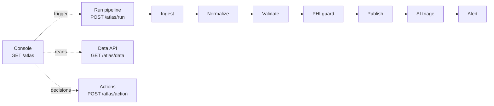

A pharma-intelligence data supply chain, end to end: raw clinical-trial and
drug-pricing feeds from three partner sources are normalized to a canonical
healthcare schema, validated against quality gates, screened for patient-level
identifiers, and published to a persistent store for downstream API delivery.
Data operations staff run and monitor it from the **Data Operations Console**.

Every partner feed is simulated, so the whole workflow runs with **no external
credentials**. The one optional external dependency is the Anthropic connector
used by AI triage, which falls back to a rule-based classifier when absent.

## Triggers

| Trigger | Entry point |
| --- | --- |
| Hourly schedule `0 * * * *` (published version only) | [Ingest](Ingest/script.ts) |
| Operator clicking *Run pipeline* in the console | `POST /atlas/run` → [Run pipeline](<Run pipeline/script.ts>) |
| Manual run of Ingest | [Ingest](Ingest/script.ts) |

The console itself is at **`GET /atlas`**. All routes are space-authenticated:
only members of this space can reach them.

## The flow

1. **[Ingest](Ingest/script.ts)** pulls a batch from three feeds with deliberately
   inconsistent shapes (FHIR-ish JSON, pipe-delimited flat file, legacy XML),
   retries a failing source with backoff, and refuses to reprocess a batch id
   that already completed.
2. **[Normalize](Normalize/script.ts)** maps phases, ISO-3166 country codes, NDC
   formatting and dates onto one canonical record, and de-duplicates on trial ID
   + NDC. A missing required source field stops the run as schema drift.
3. **[Validate](Validate/script.ts)** applies the quality gates and scores the
   batch.
4. **[PHI guard](<PHI guard/script.ts>)** quarantines anything resembling a
   patient identifier instead of publishing it.
5. **[Publish](Publish/script.ts)** commits records, rejections, quarantines,
   logs and the run summary in one transaction.
6. **[AI triage](<AI triage/script.ts>)** classifies the root cause of any failed
   or lossy run and drafts a remediation note for the owner.
7. **[Alert](Alert/script.ts)** exits non-zero on a failed run so the failure
   surfaces in monitoring with an owner-attributable payload.

[Seed](Seed/script.ts) is a manual bootstrap that resets the store to a known
demo baseline.

## Reliability and monitoring

- **Structured logs.** Every step writes single-line JSON to stderr with run ID,
  step name, timing and counts, and the same lines are persisted so the console's
  per-run timeline and the platform's monitoring view show the same data.
- **Idempotency.** Runs are keyed on batch ID; a completed batch is never
  republished. Record writes are upserts on `(trial_id, ndc)`.
- **Retries and backoff.** Ingest retries each source four times with
  250/500/1000 ms backoff before declaring an outage, and the step itself retries
  per `retry_seconds`.
- **Chaos toggle.** `simulate_failure` accepts `none` (default), `schema_drift`,
  `source_timeout` or `encoding_error`, exposed in the console so a failure can be
  induced and then recovered on demand.
- **Owner-attributable failures.** A failed run records which source, which field,
  which record, what changed versus the last good run, and who owns it.
- **Human in the loop.** Releasing a PHI quarantine and applying an AI-proposed
  remapping are both explicit operator decisions, recorded with the operator's
  authenticated email.

## Storage

One named volume, `atlas`, holding SQLite at `/storage/atlas/atlas.db`. Ingest,
Publish, AI triage, Actions and Seed mount it read-write with exclusive writer
scheduling; the Data API mounts it read-only. Tables: `runs`, `step_logs`,
`records`, `rejections`, `quarantine`, `mapping_overrides` — see `ensureSchema` in
[Ingest/lib.ts](Ingest/lib.ts). Draft branches keep their own copy of the volume.

## Side effects

Read-write, but only against its own store: the workflow writes nothing to any
external system, sends no notifications, and publishes no patient-level data.

## Common changes

- Add or change a quality gate → [Validate/script.ts](Validate/script.ts).
- Add a PHI detector → [PHI guard/script.ts](<PHI guard/script.ts>).
- Change a field mapping or add a source → [Normalize/script.ts](Normalize/script.ts)
  and the feed generators in [Ingest/lib.ts](Ingest/lib.ts). `lib.ts` is copied
  into every step, so edit `Ingest/lib.ts` and copy it across.
- Change the model or prompt → [AI triage/script.ts](<AI triage/script.ts>).
- Change the console → [Console/App.tsx](Console/App.tsx) and
  [Console/ui.tsx](Console/ui.tsx).
- Reset the demo data → run [Seed](Seed/script.ts).
