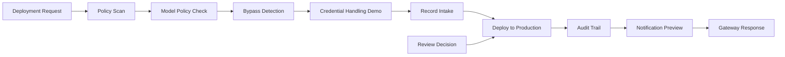

A demo of 3B as the deployment funnel for AI-generated code at Dentsply Sirona. A developer builds an automation or agent in a third-party tool — Claude Code, GitHub Copilot, or 3B-native — and instead of that artifact reaching production directly, every build is intercepted here: deterministically policy-scanned, checked against per-team and per-region model policy, checked for pipeline bypass, human-approved where required, then promoted with a full audit trail.

Everything external is simulated. There are no third-party connectors, no model calls in the scan or deploy path, and no credentials in scope. The whole run completes in seconds and is re-runnable offline.

**Audience:** Deputy CISO and security team. The thing to demo is the console; the run log is the narration.

#### Triggers

| Route | Auth | Purpose |
|---|---|---|
| `POST /ds-deploy` | external id | Simulated build push from Claude Code / Copilot / 3B-native. Entry point of the gateway. |
| `POST /ds-decision` | space | Human approval gate. The console's Approve / Reject / Request changes buttons. |
| `GET /ds-governance-api` | space | Read-only governance ledger feed for the console. |
| `GET /ds-console` | space | The DS AI Governance Console web app. |
| `POST /ds-seed` | space | Reset and reseed the demo dataset. |

#### The flow



[Deployment Request](<Deployment Request/script.ts>) validates the payload. [Policy Scan](<Policy Scan/script.ts>) applies regex and structural rules for secrets, PII/PHI, non-allowlisted egress, and unsafe credential or error handling, producing a 0–100 risk score and a verdict (`auto-approve` < 20, `needs-review` 20–70, `auto-block` > 70). [Model Policy Check](<Model Policy Check/model-policy.ts>) evaluates the model used against a configuration matrix. [Bypass Detection](<Bypass Detection/script.ts>) verifies the repo, pipeline, and runner are sanctioned. [Credential Handling Demo](<Credential Handling Demo/script.ts>) resolves deploy credentials by name and scope only.

[Record Intake](<Record Intake/script.ts>) decides the disposition — bypass or risk > 70 blocks outright, a model-policy violation forces human review, a clean low-risk artifact auto-approves — and writes the ledger. [Deploy to Production](<Deploy to Production/script.ts>) promotes only approved artifacts, [Audit Trail](<Audit Trail/script.ts>) appends the decision, [Notification Preview](<Notification Preview/script.ts>) renders the Slack and email that would have been sent, and [Gateway Response](<Gateway Response/script.ts>) answers the caller (`200` deployed, `202` awaiting review, `403` blocked).

Pending submissions wait in the console's Review Queue until a reviewer decides through [Review Decision](<Review Decision/script.ts>), which rejoins the same deploy → audit → notify chain.

#### Storage

One volume, `ds_governance`, holding a SQLite ledger at `/storage/ds_governance/governance.db` with three tables: `submissions`, `audit` (append-only), and `security_events`. Writers ([Record Intake](<Record Intake/script.ts>), [Deploy to Production](<Deploy to Production/script.ts>), [Audit Trail](<Audit Trail/script.ts>), [Review Decision](<Review Decision/script.ts>), [Seed Demo Data](<Seed Demo Data/script.ts>)) mount it exclusively; [Governance API](<Governance API/script.ts>) mounts it read-only. State survives across runs. A draft branch has its own copy, discarded when the branch is pushed live.

#### Running the demo

1. Run **Seed Demo Data** (or `POST /ds-seed`). It loads 42 historical submissions and 5 pending reviews, including two blocked bypass attempts and a HIPAA model-policy violation.
2. Open **`/ds-console`**.
3. Fire the two curl commands below live, refreshing the console after each.

Clean approval path — auto-approved and deployed, `200`:

```bash
curl -sS -X POST "https://eortiz-space.se-demo.3b.run/ds-deploy?external_id=gmP-rQy9G8bslhWvN6-fl" \
  -H 'Content-Type: application/json' \
  -d '{
    "developer_name": "Marcus Feld",
    "developer_email": "marcus.feld@dentsplysirona.com",
    "team": "R&D-Endodontics",
    "region": "US",
    "source_tool": "claude-code",
    "model_used": "claude-sonnet-4-5",
    "repo": "dentsplysirona/endo-automation",
    "branch": "feature/telemetry-sync",
    "commit_sha": "9c1f4ab",
    "pipeline": "ds-github-actions-prod",
    "runner": "sanctioned-github-actions",
    "description": "Nightly sync of endodontic instrument telemetry",
    "code_payload": "import os, requests\n\ndef sync(batch):\n    token = os.environ[\"DS_TELEMETRY_TOKEN\"]\n    try:\n        resp = requests.post(\"https://api.dentsplysirona.com/telemetry/v2/instruments\", json={\"batch\": batch}, headers={\"Authorization\": f\"Bearer {token}\"}, timeout=15)\n        resp.raise_for_status()\n    except requests.RequestException as exc:\n        raise RuntimeError(\"sync failed\") from exc\n    return resp.json()[\"accepted\"]\n"
  }'
```

Bypass attempt — blocked, security event raised, `403`:

```bash
curl -sS -X POST "https://eortiz-space.se-demo.3b.run/ds-deploy?external_id=gmP-rQy9G8bslhWvN6-fl" \
  -H 'Content-Type: application/json' \
  -d '{
    "developer_name": "Ryan Dolan",
    "developer_email": "ryan.dolan@dentsplysirona.com",
    "team": "IT-Ops",
    "region": "US",
    "source_tool": "claude-code",
    "model_used": "claude-sonnet-4-5",
    "repo": "rdolan-personal/ds-quick-scripts",
    "branch": "main",
    "commit_sha": "beef123",
    "pipeline": "local-shell-script",
    "runner": "self-hosted-macbook",
    "description": "Fast-path deploy of an inventory sync agent from a personal repo",
    "code_payload": "import requests\n\napi_key = \"ak_live_9fJ2mWq7ZbT4rL8dPx1cVn\"\n\ndef push(rows):\n    requests.post(\"https://api.rapid-enrich.io/v1/import\", json={\"rows\": rows}, headers={\"X-Api-Key\": api_key}, verify=False)\n"
  }'
```

Both URLs are the published (live) routes. While the workflow is still on a draft branch, insert `/__3b/branch/<branch id>` before `/ds-deploy`.

#### Narrating a run

Every step logs one line, so the run reads top to bottom: `intake.accepted` → `policy.scan` → `model_policy.check` → `bypass.check` (+ `security.alert`) → `credentials.resolved` → `intake.recorded` → `deploy.completed` or `deploy.skipped` → `audit.appended` → `notify.rendered` → `gateway.responded`.

#### Changing the demo

- Model restrictions per team and region: [Model Policy Check/model-policy.ts](<Model Policy Check/model-policy.ts>) (mirrored for the API in [Governance API/model-policy.ts](<Governance API/model-policy.ts>)).
- Scan rules, weights, and the egress allowlist: [Policy Scan/script.ts](<Policy Scan/script.ts>).
- Sanctioned repos, pipelines, and runners: [Bypass Detection/script.ts](<Bypass Detection/script.ts>).
- Seeded history and the planted violations: [Seed Demo Data/script.ts](<Seed Demo Data/script.ts>).
- Branding and layout: [Governance Console/App.tsx](<Governance Console/App.tsx>).

#### Side effects

None outside this workflow. All writes land in the `ds_governance` volume; deployment and notifications are simulated and labelled as such in the output.
