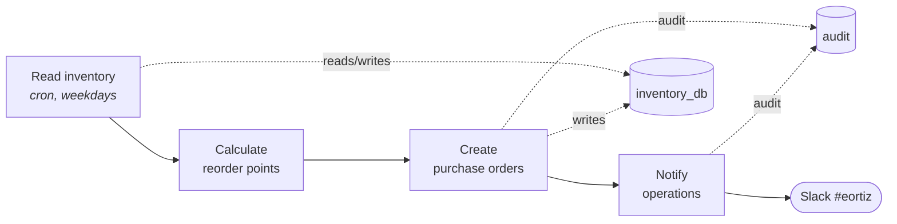

Watches stock levels every weekday, works out which items have fallen below the point where they need reordering, raises purchase orders for them grouped by supplier, and posts a digest to the operations team in Slack. Nobody has to open a spreadsheet to find out that the cartons are about to run out.

## Trigger

A cron on [Read inventory](<Read inventory/config.toml>): `0 13 * * 1-5` — 13:00 UTC, weekdays. Cron only fires on the published version; on a draft, run the step by hand. There is no HTTP route — this workflow is a scheduled job, not an endpoint.

## The flow

1. **[Read inventory](<Read inventory/README.md>)** takes today's snapshot, books in any purchase order that reached its expected date, and draws stock down by a day's usage.
2. **[Calculate reorder points](<Calculate reorder points/README.md>)** scores every item: `reorder point = avg daily usage × (lead time days + safety stock days)`, compared against `on hand + on order − allocated`. Items land in one of four bands — healthy, low, critical, out of stock — and get a suggested order quantity rounded to pack size and floored at the supplier's minimum.
3. **[Create purchase orders](<Create purchase orders/README.md>)** groups the flagged items by supplier into one PO each, writes header and line records, and moves the ordered quantities into `On Order`.
4. **[Notify operations](<Notify operations/README.md>)** posts the digest to Slack — every run, including quiet ones.

## Inputs and outputs

No caller input; the schedule is the only trigger. The observable outputs are the purchase order records in the `inventory_db` volume, the Slack message, and the audit trail.

## The inventory data is mocked

The Airtable connector isn't available in this space, so the base is stood up locally in [`Read inventory/store.ts`](<Read inventory/store.ts>) — 19 SKUs across five suppliers, held in the `inventory_db` volume at `/storage/inventory_db/db.json`. Records use Airtable's exact REST shape (`{ id, createdTime, fields }`) with human field names, and stock genuinely moves between runs: usage draws it down, purchase orders put it back.

**To point this at a real Airtable base**, attach an Airtable connector to `Read inventory` and `Create purchase orders`, then replace the four functions in `store.ts`:

| Function | Real call |
|---|---|
| `readDb` | `GET https://api.airtable.com/v0/{baseId}/Inventory` (paginate on `offset`) |
| `writeDb` | `PATCH https://api.airtable.com/v0/{baseId}/Inventory` in batches of 10 records |
| `seed` | delete — the base already exists |
| PO creation in [`Create purchase orders/script.ts`](<Create purchase orders/script.ts>) | `POST` to the `Purchase Orders` and `Purchase Order Lines` tables |

The field names in `ItemFields` are the Airtable column names, so a matching base needs: `SKU`, `Item Name`, `Category`, `Supplier`, `Supplier Email`, `Unit Cost`, `On Hand`, `Allocated`, `On Order`, `Avg Daily Usage`, `Lead Time Days`, `Safety Stock Days`, `Review Period Days`, `Min Order Qty`, `Pack Size`, `Discontinued`. Nothing outside `store.ts` and the PO-writing block knows where the data lives.

## External services

Slack only, via `chat.postMessage` from [Notify operations](<Notify operations/README.md>). The connector must be attached to that step and its bot invited to `#eortiz`.

## Side effects

Read-write. Each run mutates the inventory store, may raise purchase orders, and posts to Slack. Nothing is emailed to suppliers — a PO here is a record and a notification, not a commitment sent outside the company.

## Operational notes

- **Duplicate orders** are prevented by a derived PO number (`PO-YYYYMMDD-SUPP`) plus an `On Order` netting rule. Re-running the same day skips groups already raised; it does not raise a second order.
- **Logs.** Every step emits single-line JSON on stderr with `run_id`, so one run is traceable across all four. Consequential actions — orders raised, lines skipped, Slack posts — also append to `/storage/audit/YYYY-MM-DD.jsonl` in the shared `audit` volume, which outlives the 10 KiB stderr cap.
- **Failure modes.** A missing inventory store, or a Slack rejection such as `not_in_channel`, exits non-zero and stops the run rather than reporting a false success.
- **Volumes** are `concurrency=exclusive`: both `inventory_db` and `audit` are read-modify-write of shared files.

## Pointers for common changes

- Reorder formula and status bands → [`Calculate reorder points/script.ts`](<Calculate reorder points/script.ts>)
- Slack channel and message layout → [`Notify operations/script.ts`](<Notify operations/script.ts>) (`CHANNEL` is the first constant)
- Schedule → `cron` in [`Read inventory/config.toml`](<Read inventory/config.toml>)
- Demo stock levels and suppliers → `SEED_ROWS` in [`Read inventory/store.ts`](<Read inventory/store.ts>)
- Emailing orders to suppliers → add a step downstream of `Create purchase orders`; each PO already carries `Supplier Email`
